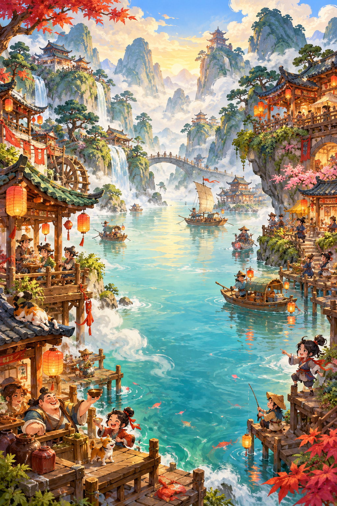

<div align="center">

# Dreaming of Jianghu

**An ink-wash physics roguelike. Build a town, release a pearl, pay the emperor.**

[**Play in your browser →**](https://tomaslin.github.io/jianhu/) · [Gameplay guide](GAMEPLAY.md) · [Design notes](DESIGN.md)

[](https://github.com/tomaslin/jianhu/actions/workflows/pages.yml)

<a href="https://tomaslin.github.io/jianhu/">
  
</a>

*Eight painted worlds. A thousand strange collisions.*

</div>

## Play

Open **[Dreaming of Jianghu](https://tomaslin.github.io/jianhu/)** in Safari or another browser with WebGL 2.0. The game fits a portrait frame on phones and desktop screens. The first load downloads the game; tap or click to unlock audio.

1. Choose a scroll and select **Play**.
2. Pick a companion, then tap an empty ring to place it. The opening trio is free.
3. Select **Play**, then swipe down the board to aim and launch. A longer swipe adds power.
4. Tap near a falling pearl to spend Qi on a parry. Use **Places** to upgrade a building and **Kung Fu** to train a resident. Collect your earnings and build again.
5. Pay tribute every third day. Survive through day 15 to seal the scroll.

Runs save in your browser. Use **Continue Dream** to return, and the gear button for music, haptics, contrast, reduced motion and spectacle settings.

## Inside the game

| | |
| --- | --- |
| **Eight worlds** | Painted landscapes with different gravity, terrain, rhythms and economies |
| **A living town** | 48 citizens and contraptions, physical rooftops, alliances and five building levels |
| **Martial arts** | Three shot stances, Qi parries, 36 ordered routes and four-form training lineages |
| **A changing run** | 56 boons, 24 commissions, eight rivals and escalating mayhem |

See the **[gameplay guide](GAMEPLAY.md)** for controls, systems and the eight scrolls.

## Run locally

Open [project.godot](project.godot) in **Godot 4.7.2**, then press **F5**. The project uses the Compatibility renderer and a 390 × 844 logical canvas.

```sh
godot --headless --path . --editor --import
godot --headless --path . --script res://tests/smoke.gd
godot --headless --path . --script res://tests/trajectory.gd
```

## Deployment

Pushes to `main` run the native mechanics and physics tests, export the single-threaded WebAssembly game, validate its assets, then publish to **[GitHub Pages](https://tomaslin.github.io/jianhu/)**. Pull requests run the build checks without publishing.

For a fork, enable **Settings → Pages → Source: GitHub Actions** once before deploying. The workflow uses the repository’s existing Pages configuration; its token does not create a Pages site. See **[Web export instructions](WEB_EXPORT.md)** for a manual build.

## Source map

| Path | Contents |
| --- | --- |
| `scenes/` | Main Godot scene |
| `scripts/` | Game state, physics, citizens, HUD, sound and content catalogs |
| `assets/` | Eight painted worlds, pearl textures, original audio and bundled fonts |
| `tests/` | Mechanics, state transitions and eight-world physics checks |
| `tools/` | Audio generation, Web templates, responsive shell and export validation |
| `.github/workflows/pages.yml` | Build, test and GitHub Pages deployment |

**Art:** original AI-assisted ink-wash paintings. **Sound:** original synthesized music and effects. **Fonts:** DejaVu Sans/Serif ([license](assets/fonts/FONT_LICENSE.txt)).
